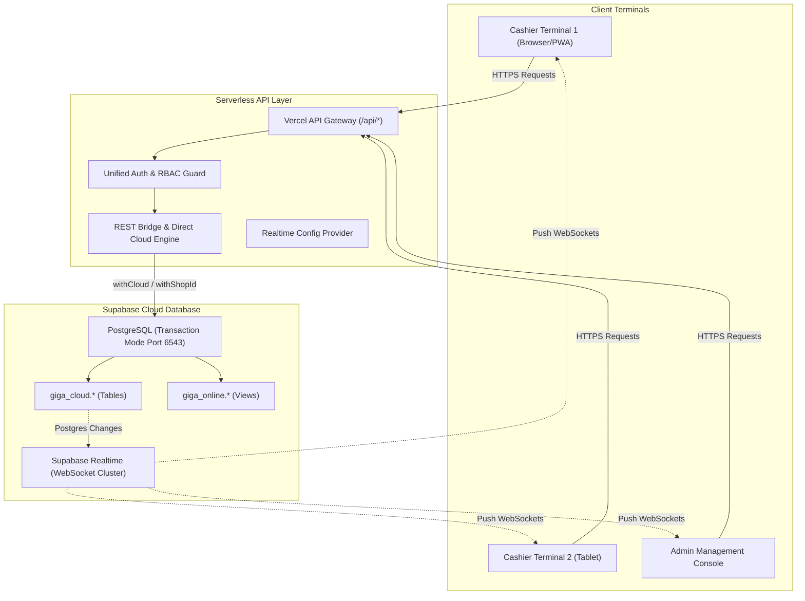
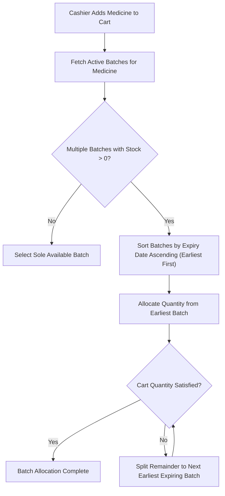
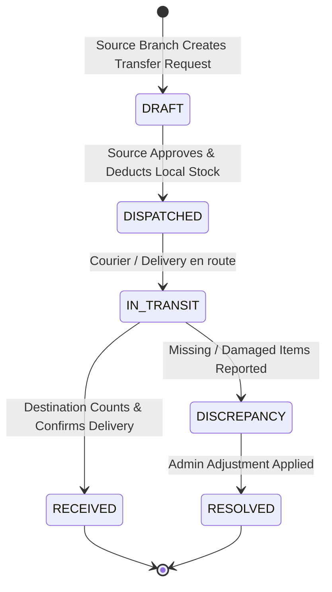

# Software Requirements Specification (SRS)
## GIGA CHEMIST — Cloud-Native Pharmacy Point of Sale & Inventory Management System

**Document Version:** 2.0  
**Status:** Approved / Active Baseline  
**Target Environment:** Fully Online / Cloud-First (Vercel Serverless + Supabase PostgreSQL)  
**System Repository:** `b:\GIGA-CHEMIST-POS`

---

## 1. Introduction

### 1.1 Purpose
This document specifies the software requirements for **GIGA CHEMIST**, a multi-tenant, cloud-native pharmacy Point of Sale (POS) and inventory control system. It defines the system architecture, data models, functional requirements (including newly implemented direct cloud write bridges, multi-terminal live sync, and immutable movement ledgers), and future functional additions (FEFO batch dispensing, inter-branch transfers, digital receipts, and accounting integrations).

### 1.2 Scope of System
GIGA CHEMIST operates as a zero-infrastructure pharmacy workstation:
- **No Local Server or Sync Worker Required:** Terminals run as responsive Single-Page Progressive Web Applications (PWA) in modern browsers, tablets, and mobile devices.
- **Authoritative Cloud Database:** Supabase PostgreSQL (`giga_cloud.*` schema) serves as the single source of truth for catalog items, batch expiry, stock levels, sales, cashier shifts, and financial ledgers.
- **Serverless API Layer:** Vercel serverless Express routes enforce multi-tenant isolation (`shop_id`), role-based access control (RBAC), transactional consistency, and idempotency.

---

## 2. Overall Description & Architecture

### 2.1 System Architecture

### 2.2 User Classes & Characteristics

| Role | Permissions & Responsibilities |
| :--- | :--- |
| **Global Admin** | System owner across all branches. Can create shops, register users, set system configurations, and perform cross-shop audits. |
| **Shop Admin / Manager** | Controls shop inventory, sets prices, performs physical stock adjustments, reviews/closes staff cashier shifts, manages suppliers, and creates purchase orders. |
| **Cashier / Dispenser** | Executes sales checkout, manages individual shift tills (float, cash drops, closeout), handles customer lookups, and submits return requests. |

---

## 3. Specific Functional Requirements

### 3.1 Direct Cloud Writes & REST Bridge *(Implemented)*

#### 3.1.1 Overview
Eliminates asynchronous command queues and offline sync delays. Every administration action performed on frontend forms or modals executes directly against `giga_cloud.*` tables in atomic transactions.

#### 3.1.2 Endpoint Specifications

| Endpoint | HTTP Method | Direct Action | Result Payload |
| :--- | :--- | :--- | :--- |
| `/api/medicines` | `POST` | Inserts into `giga_cloud.medicines` | `{ medicine: Medicine }` |
| `/api/medicines/:id` | `PUT` | Updates metadata & categorical classifications | `{ medicine: Medicine }` |
| `/api/medicines/:id/pricing` | `PATCH` | Updates retail, wholesale, cost, and reorder levels | `{ medicine: Medicine }` |
| `/api/medicines/:id` | `DELETE` | Preflight verifies zero stock, then soft-deletes | `{ success: true }` |
| `/api/inventory/set-stock` | `POST` | Resets baseline quantity (`delta = 0`) | `{ success: true, medicine, batch }` |
| `/api/inventory/add-stock` | `POST` | Increments `delta_since_baseline` on batch | `{ success: true, medicine, batch }` |
| `/api/inventory/remove-stock` | `POST` | Decrements `delta_since_baseline` with zero floor | `{ success: true, medicine, batch }` |
| `/api/batches/:id/expiry` | `POST` | Updates batch expiry date and risk status | `{ success: true, batch }` |
| `/api/customers` | `POST` / `PUT` | Upserts customer profile into cloud | `{ customer: Customer }` |
| `/api/suppliers` | `POST` / `PUT` | Upserts supplier contact and tax PIN | `{ supplier: Supplier }` |
| `/api/expenses` | `POST` / `DELETE`| Records operational cash outflows or voids | `{ expense: Expense }` |
| `/api/purchases` | `POST` | Creates purchase order & restocks batches | `{ purchase, medicines, batches }` |
| `/api/sales/:id/void` | `POST` | Voids sale and returns items to stock | `{ success: true }` |

---

### 3.2 Real-Time Multi-Terminal Sync *(Implemented)*

#### 3.2.1 Purpose & Design
Maintains sub-second catalog and stock consistency across multiple terminals within the same shop without polling or page reloads.

#### 3.2.2 Workflow
1. **Client Startup:** Client invokes `GET /api/realtime/config` to obtain the public Supabase URL, anon key, and authorized `shop_id`.
2. **WebSocket Subscription:** The browser establishes a connection with Supabase Realtime on channel `shop-pos:<shop_id>`.
3. **Table Change Listeners:**
   - `giga_cloud.stock_levels`: Emits instant stock delta changes.
   - `giga_cloud.medicines`: Pushes price edits, new medicines, and reorder alerts.
   - `giga_cloud.medicine_batches`: Pushes newly received batches and updated expiry dates.
   - `giga_cloud.sales`: Triggers live till reconciliation updates on cashier screens.
4. **Cache Reactivity:** Upon receipt of events, the client triggers `CATALOG_REFRESHED_EVENT`, re-hydrating IndexedDB and refreshing React components.

---

### 3.3 Online Stock Movement Ledger & Audit Trail *(Implemented)*

#### 3.3.1 Immutable Ledger Specification
Every inventory modification is recorded in `giga_cloud.inventory_movements`:
- **Movement Types:** `SALE`, `STOCK_ADD`, `STOCK_REMOVE`, `STOCK_SET`, `PURCHASE_RESTOCK`, `RETURN`.
- **Logged Attributes:** `movement_id`, `shop_id`, `medicine_id`, `batch_id`, `delta`, `previous_quantity`, `new_quantity`, `reason`, `notes`, `user_id`, `device_id`, `occurred_at`.
- **Query Interfaces:**
  - `GET /api/inventory/movements`: Scoped to the caller's authorized shop, returns up to 1,000 recent stock movement events.
  - `GET /api/audit`: Returns administrative command executions and permission-sensitive modifications.
  - `GET /api/audit/stock-adjustments`: Formats comprehensive stock overrides for the compliance register.

---

### 3.4 Pharmacy FEFO (First-Expired, First-Out) Auto-Dispense *(Planned)*

#### 3.4.1 Requirement Description
During POS checkout, the system must automatically allocate batches based on expiration date to prevent financial loss from expired stock.

#### 3.4.2 Visual Warnings
- **Red Badge:** Expired (blocked from sale).
- **Amber Badge:** Expiring within 30 days (requires cashier confirmation).
- **Yellow Badge:** Expiring within 90 days.

---

### 3.5 Multi-Branch Inter-Shop Stock Transfers *(Planned)*

#### 3.5.1 Workflow & State Transitions
Allows pharmacies with multiple physical branches to rebalance inventory.

#### 3.5.2 Technical Constraints
- The deduction from `Shop A` and crediting to `Shop B` must execute within an atomic PostgreSQL transaction.
- Preserves original batch number, manufacturer, and expiry date across branches.

---

### 3.6 Thermal ESC/POS & WhatsApp/SMS Receipts *(Planned)*

#### 3.6.1 Hardware Thermal Printing
- Integration with WebUSB / WebBluetooth APIs to directly dispatch ESC/POS raw bytecode to 58mm and 80mm thermal receipt printers without triggering OS print dialogues.
- Customizable header/footer text, shop KRA/Tax PIN, cashier name, and barcode footer.

#### 3.6.2 Digital Receipt URL
- Generation of public verifiable receipt link: `/receipt/:sale_id?sig=<hmac>`.
- One-click share via WhatsApp Web / WhatsApp Business API and SMS gateway (Africa's Talking / Twilio).
- Reduces thermal paper costs and provides customers with digital tax receipts.

---

### 3.7 Customer Store Credit & Khata Ledger *(Planned)*

#### 3.7.1 Functional Overview
- Support for regular patients (chronic disease medication management) to purchase on credit.
- Maintains customer credit limits, outstanding balances, and aging brackets (0–30 days, 31–60 days, 60+ days).
- Flexible partial settlement workflow linked to cashier shift cash/MPesa declarations.

---

### 3.8 End-of-Day (EOD) Automated Summary & Accounting *(Planned)*

#### 3.8.1 Automated EOD Digest
- Scheduled serverless cron trigger at closing time (e.g. 21:00 local time).
- Automatically aggregates:
  - Total Gross Revenue, Cost of Goods Sold (COGS), and Gross Margin.
  - Cash collected vs. MPesa/Card electronic settlements.
  - Till cash discrepancy report across all closed cashier shifts.
  - Total discounts granted and list of voided transactions.
- Dispatches automated summary via email (Nodemailer) and WhatsApp to shop owners.

#### 3.8.2 Accounting Export
- One-click CSV and JSON export conforming to QuickBooks Online and Xero standard journal import formats.

---

## 4. Non-Functional Requirements

### 4.1 Multi-Tenant Isolation
- Every database query must strictly enforce `shop_id` scoping.
- Cloud views in `giga_online.*` utilize session settings (`set_config('giga.shop_id', ...)`), ensuring zero cross-tenant data leakage.

### 4.2 Security & Authentication
- JWT bearer tokens signed using HMAC-SHA256 (`JWT_SECRET`).
- Role-based permissions evaluated on every request via `requirePermission()`.
- Session revocation capability with atomic `token_version` incrementing.

### 4.3 Resilience & Zero-Lag Offline UI
- PWA service worker caches all static assets and code bundles.
- Dexie IndexedDB maintains an in-browser mirror of the medicine catalog, enabling instantaneous barcode scanning and search (<10ms).
- On network interruption, graceful degradation flags active network status without interrupting active form input.

---

## 5. Implementation Roadmap Matrix

| Feature Module | Status | Technical Target | Priority |
| :--- | :--- | :--- | :--- |
| **Direct Cloud Writes Engine** | **Completed** | `server/online/directAdmin.ts` | Immediate |
| **All Shops Online Status** | **Completed** | `server/online/remoteAdmin.ts` | Immediate |
| **Direct REST UI Bridge** | **Completed** | `server/online/restBridge.ts` | Immediate |
| **Realtime Multi-Terminal Sync**| **Completed** | `src/services/realtimeSync.ts` | Immediate |
| **Online Movement Ledger** | **Completed** | `giga_cloud.inventory_movements` | Immediate |
| **FEFO Auto-Allocation** | Ready to Implement | `server/online/sales.ts` / POS Cart | Phase 2 |
| **Thermal / WhatsApp Receipts** | Ready to Implement | `src/services/thermalPrinter.ts` | Phase 2 |
| **Inter-Branch Stock Transfer** | Planned | `giga_cloud.stock_transfers` | Phase 3 |
| **Customer Store Credit** | Planned | `giga_cloud.customer_credit` | Phase 3 |
| **Automated EOD Digest** | Planned | `server/online/cron.ts` | Phase 3 |
