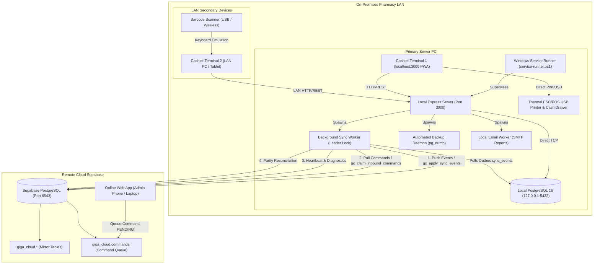
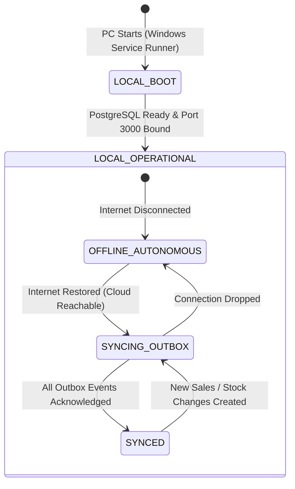

# Software Requirements Specification (SRS)
## GIGA CHEMIST — Local-Server & Hybrid Offline-First Pharmacy System

**Document Version:** 1.5 (Legacy/Hybrid Architectural Baseline)  
**Status:** Historical & Architectural Specification  
**Architecture:** On-Premises Local Server + Offline-First LAN Terminals + Asynchronous Cloud Sync  
**Target Environment:** Local PC / Windows 11 On-Premises Server (PostgreSQL 16 + Node.js/Express) + Supabase Cloud  
**System Repository:** `b:\GIGA-CHEMIST-POS`

---

## 1. Introduction

### 1.1 Purpose
This Software Requirements Specification (SRS) documents the complete requirements, operational architecture, and data flow of the **GIGA CHEMIST Local-Server / Hybrid System**. This architecture was designed for retail pharmacies operating in environments with intermittent, unstable, or absent internet connectivity, where the local on-premises computer was the **authoritative master** of all operational and transactional data.

### 1.2 Scope of System
Under the local-server model:
- **Local Master Server:** An on-site Windows/Linux computer hosted the authoritative local PostgreSQL database and Node.js/Express backend.
- **Full Offline Operational Autonomy:** The pharmacy remained 100% operational (dispensing, cash/card/mobile money checkout, inventory adjustments, shift balancing, thermal receipt printing) when disconnected from the internet.
- **Asynchronous Cloud Sync (Hybrid Mode):** A local background worker running transactional outbox synchronization pushed committed events to Supabase Cloud and polled for remote administration commands.
- **LAN Multi-Terminal Architecture:** Counter terminals and tablet devices connected over the local area network (`http://<SERVER_IP>:3000`) to the on-site server.

### 1.3 Definitions, Acronyms, and Abbreviations
- **POS:** Point of Sale.
- **PWA:** Progressive Web Application.
- **FEFO:** First-Expired, First-Out (pharmaceutical stock rotation protocol).
- **Outbox Pattern:** Transactional database design where local business modifications and their corresponding synchronization events are committed in the same database transaction.
- **Advisory Lock:** A PostgreSQL application-level locking mechanism used for single-worker leader election.
- **Supabase Cloud:** The remote PostgreSQL database (`giga_cloud.*` schema) acting as a read-only mirror and remote control relay.

---

## 2. Overall Description & Architecture

### 2.1 System Architecture



### 2.2 Operational States and Connectivity Modes



### 2.3 User Roles & Authorization Hierarchy

| Role | Operational Scope | Capabilities on Local Server |
| :--- | :--- | :--- |
| **ADMIN** | Shop-Wide Master | Full access to inventory, pricing overrides, shift audits, staff user creation, local backups, restore drills, and system settings. |
| **MANAGER** | Operational Supervisor | Approves return requests, receives purchase orders, conducts stocktaking, views business reports, and oversees cash drops. |
| **CASHIER** | Point of Sale Operator | Operates shift tills (float, sales, returns submission, receipt reprints, closeout cash counting). Cannot alter selling prices or edit medicine definitions. |

---

## 3. Specific Functional Requirements

### 3.1 Local Authoritative PostgreSQL Core Engine

#### 3.1.1 Authoritative Formularies & FEFO Batch Control
- **Table:** `medicines`
  - Stores pharmaceutical master records (name, generic name, brand name, SKU, barcode, unit, strength, category, reorder level).
  - Enforces non-negative stock constraints (`current_stock >= 0`).
  - Tracks pricing tiers: `purchase_price`, `selling_price`, `wholesale_price`, `min_selling_price`.
- **Table:** `medicine_batches`
  - Maintains individual batch numbers, manufacturing dates, expiry dates, and purchase invoice tracking.
  - Automatically classifies batch risk into `valid`, `expiring_soon` (within 90 days), and `expired`.
  - Disallows selling expired batches at the point of sale.

#### 3.1.2 Sales Checkout & Atomic Stock Depletion
- **Tables:** `sales`, `sale_items`, `payments`
- Checkout operates inside an explicit PostgreSQL `BEGIN ... COMMIT` transaction:
  1. Verifies that the cashier has an open cashier shift.
  2. Decrements `quantity_available` on specific `medicine_batches` and updates `current_stock` on `medicines`.
  3. Verifies that stock does not become negative (raises exception on stock exhaustion).
  4. Inserts immutable rows into `sales`, `sale_items`, and `payments` (supporting split payments: Cash, MPesa, Card, Bank Transfer).
  5. Inserts an immutable movement row into `inventory_movements`.
  6. Inserts a synchronization event row into `sync_events` within the identical transaction.

#### 3.1.3 Cashier Shift Lifecycle & Cash Variance
- **Table:** `cashier_shifts`
  - Requires opening float declaration before any sale can be processed on a terminal.
  - Computes continuous expected cash (`opening_float + cash_sales - cash_refunds - cash_expenses`).
  - On shift closeout: records cashier's actual cash count, calculates cash variance (`actual_cash - expected_cash`), and requires manager/admin review.

---

### 3.2 Offline-First Dexie IndexedDB In-Browser Cache

#### 3.2.1 Client Storage Specification
- Every browser instance on the LAN (whether the server terminal or a tablet) initializes an IndexedDB database named `GigaChemistPOS`.
- Stores cached copies of: `medicines`, `medicine_batches`, `categories`, `customers`, `suppliers`, `settings`, `held_sales`.

#### 3.2.2 Fast Search & Optimistic Cart Operations
- Barcode scanning and search queries execute locally in IndexedDB (<10ms latency), ensuring immediate responsiveness even under high network latency on Wi-Fi.
- On receipt of server responses, `refreshCacheAfterCommit` updates Dexie records with the server's committed state.

---

### 3.3 Transactional Outbox & Background Sync Worker

#### 3.3.1 Transactional Outbox Schema (`sync_events`)
```sql
CREATE TABLE sync_events (
    id UUID PRIMARY KEY DEFAULT gen_random_uuid(),
    seq BIGSERIAL UNIQUE,
    shop_id UUID NOT NULL,
    event_type VARCHAR(60) NOT NULL,
    entity_type VARCHAR(60) NOT NULL,
    entity_id VARCHAR(100) NOT NULL,
    payload JSONB NOT NULL,
    status VARCHAR(20) NOT NULL DEFAULT 'PENDING' CHECK (status IN ('PENDING', 'PROCESSING', 'SYNCED', 'FAILED')),
    attempt_count INTEGER NOT NULL DEFAULT 0,
    next_attempt_at TIMESTAMPTZ NOT NULL DEFAULT CURRENT_TIMESTAMP,
    synced_at TIMESTAMPTZ,
    last_error TEXT
);
```

#### 3.3.2 Leader Election via PostgreSQL Advisory Locks
- To prevent multiple Node.js processes or rapid server restarts from uploading conflicting batches concurrently, the worker acquires a session-level advisory lock:
  ```sql
  SELECT pg_try_advisory_lock(7420317001) AS is_leader;
  ```
- If the lock is not acquired, the background worker remains idle.

#### 3.3.3 Batch Uploading & Exponential Backoff
- The worker claims up to `SYNC_BATCH_SIZE` (default 50) due events using `FOR UPDATE SKIP LOCKED`.
- Batches are posted to Supabase via RPC `gc_apply_sync_events`.
- **Transient Failures (HTTP 5xx, DNS, Timeout):** Event status remains `PENDING` with exponential backoff:
  $$\text{Delay} = \min(300\text{s}, 5\text{s} \times 2^{\text{failures}})$$
- **Terminal Rejections (HTTP 4xx / Schema Conflict):** Event is marked `FAILED` with error text and flagged for administrator inspection.

---

### 3.4 Inbound Cloud Command Execution & Idempotency Engine

#### 3.4.1 Remote Administration Workflow
When a remote pharmacy owner performed catalog, pricing, or stock adjustments from the cloud web application:
1. The remote web application inserted a row into `giga_cloud.commands` with `status = 'PENDING'`.
2. The local sync worker polled for inbound commands via RPC `gc_claim_inbound_commands`.
3. The local server verified command idempotency against table `sync_inbound_commands`:
   ```sql
   CREATE TABLE sync_inbound_commands (
       command_id UUID PRIMARY KEY,
       idempotency_key VARCHAR(255) NOT NULL UNIQUE,
       shop_id UUID NOT NULL,
       command_type VARCHAR(60) NOT NULL,
       payload JSONB NOT NULL,
       status VARCHAR(20) NOT NULL CHECK (status IN ('APPLIED', 'REJECTED')),
       result JSONB,
       error TEXT,
       applied_at TIMESTAMPTZ,
       acked_at TIMESTAMPTZ
   );
   ```
4. The local server executed the requested change in a local PostgreSQL transaction (e.g. updating medicine prices or stock).
5. The local result was reported back to the cloud as `APPLIED` or `REJECTED`, and the local event was uploaded via the normal outbox.

---

### 3.5 Authoritative Inventory Mirror & Parity Reconciliation

#### 3.5.1 Cryptographic Parity Fingerprinting
- Every 120 seconds, the local sync worker calculated a SHA-256 fingerprint representing the complete inventory state of the shop:
  - Sorted concatenation of all `(medicine_id, current_stock, batch_id, quantity_available)`.
- Compared local fingerprint with cloud mirror fingerprint returned by `gc_get_inventory_fingerprint`.

#### 3.5.2 Self-Healing Snapshot Publishing
- If a hash mismatch was detected (indicating missed sync packets or out-of-order events):
  1. The local server generated an authoritative snapshot of all medicines, batches, and stock levels.
  2. Uploaded the snapshot via `gc_apply_inventory_snapshot`.
  3. Overwrote cloud mirror stock levels to guarantee 100% cloud parity without requiring manual intervention.

---

### 3.6 Shop Identity & Cross-Shop Isolation Safeguards

#### 3.6.1 Stable Hardware/Database Identity
- **Table:** `shop_identity` (single-row table with `id = 1`).
- Stores the shop's permanent UUID, shop code, and branch name.
- Created once upon installation and persisted across database backups and server migrations.
- If `.env` configured `SHOP_ID` conflicted with `shop_identity.shop_id`, the server halted startup to prevent cross-shop data corruption.

---

### 3.7 Cloud Heartbeat, Diagnostics & Telemetry

#### 3.7.1 Heartbeat Frequency & Payload
- Dispatched every 60 seconds (configurable via `HEARTBEAT_INTERVAL_SECONDS`).
- Telemetry payload delivered to cloud RPC `gc_record_heartbeat`:
  - `device_id`, `app_version`, `git_commit`, `started_at`, `uptime_seconds`.
  - Storage telemetry: `disk_total_bytes`, `disk_free_bytes` (warns if free space < 2 GB).
  - Outbox status: `outbound_pending`, `outbound_failed`, `inbound_unacked`.
  - Database status: `db_healthy = true`, connection pool utilization.
  - Alert flags: PostgreSQL crash recovery flags, power loss warnings.

---

### 3.8 Local Operations, Automated Database Backups & Pruning

#### 3.8.1 Automated Backup Service
- **Module:** `server/ops/backup.ts`
- Uses native `pg_dump` to create compressed SQL dumps at scheduled intervals (default: daily at 23:00).
- Dumps stored in local directory `backups/` and verified with schema checksum validation.
- **Retention Policy:**
  - Keeps all daily backups for the last 14 days (`BACKUP_KEEP=14`).
  - Keeps 1 weekly backup for the last 8 weeks (`BACKUP_KEEP_WEEKLY=8`).
  - Automatically prunes older backups to prevent disk exhaustion.

---

### 3.9 Local Hardware & Peripheral Integration

#### 3.9.1 Thermal Receipt Printing (ESC/POS)
- Local Node.js service interfaced with USB, Serial, and Network thermal printers (58mm and 80mm).
- Dispatches raw ESC/POS command sequences:
  - Text alignment, bold/double-height typography, separator rules.
  - Custom receipt header/footer, Tax PIN, and cashier identifiers.
  - Cash drawer kick pulse: `ESC p 0 25 250` (pins 2 and 5) sent upon cash checkout completion.

#### 3.9.2 Barcode Scanners
- Standard 1D/2D USB and Bluetooth barcode scanners operating in HID Keyboard Emulation mode.
- Global keystroke buffer in React client detects scanner speed (<30ms per character with carriage return suffix), directing input to the POS cart regardless of current form focus.

---

### 3.10 Windows 11 Production Deployment & Service Runner

#### 3.10.1 Background Supervision Architecture
- **Script:** `deployment/windows/service-runner.ps1`
- Managed via Windows Task Scheduler (`GigaChemistPOS_Service` running at system boot under `NT AUTHORITY\SYSTEM`).
- **Startup Protocol:**
  1. Checks port 3000 singleton status (terminates orphan Node processes).
  2. Performs PostgreSQL connectivity loop (polls `127.0.0.1:5432` up to 60 seconds until database accepts queries).
  3. Verifies production assets (`dist/index.html`).
  4. Launches `node server.ts` with output redirection to `logs/startup.log` and `logs/server.log`.
  5. Windows Firewall configuration automatically allows inbound TCP traffic on port 3000 from the private subnet for counter LAN PCs.

---

## 4. External Interface Requirements

### 4.1 User Interfaces
- Responsive web app rendering in Chrome/Edge PWA (1024x768 minimum POS resolution).
- Dark slate header displaying multi-layer connectivity status:
  - **Local Server:** Online / Offline.
  - **Database:** Online / Offline.
  - **Internet Connection:** Connected / Disconnected.
  - **Cloud Sync:** Synced / Syncing ($N$ queued) / Sync Error.

### 4.2 Software Interfaces
- **Local PostgreSQL:** PostgreSQL 16 x64 listening exclusively on `127.0.0.1:5432`.
- **Operating System:** Windows 11 Pro / Enterprise (or Ubuntu Server 22.04 LTS).
- **Node.js Runtime:** Node.js v20+ LTS with native ES modules.
- **Supabase Cloud RPCs:**
  - `gc_apply_sync_events`
  - `gc_claim_inbound_commands`
  - `gc_ack_inbound_command`
  - `gc_record_heartbeat`
  - `gc_get_inventory_fingerprint`
  - `gc_apply_inventory_snapshot`

---

## 5. Non-Functional Requirements

### 5.1 Fault Tolerance & Zero-Internet Resilience
- **Requirement:** The pharmacy must never be prevented from dispensing or collecting payment due to external network failures.
- **Verification:** Disconnecting WAN Ethernet or turning off Wi-Fi routers must result in zero UI errors or transaction aborts.

### 5.2 Performance & Transaction Throughput
- **Local Read Latency:** Catalog searches and barcode scans resolve in $<15\text{ms}$.
- **Checkout Latency:** Full atomic commit of sale, inventory movements, and outbox event completes in $<80\text{ms}$ on standard Intel Core i3 / 8GB RAM hardware.

### 5.3 Data Integrity & Crash Consistency
- Local PostgreSQL operates with `wal_level = replica`, `fsync = on`, and `synchronous_commit = on`.
- Sudden power loss during checkout rolls back via standard ACID write-ahead logging; uncommitted sales are never partially recorded.

---

## 6. Architectural Comparison: Legacy Local-Server vs. Cloud-Only POS

| Characteristic | Legacy Local-Server System | Modern Cloud-Only System |
| :--- | :--- | :--- |
| **Authoritative Database** | Local PostgreSQL (`127.0.0.1:5432`) | Supabase Cloud PostgreSQL (`giga_cloud.*`) |
| **On-Site Infrastructure** | Requires dedicated server PC running Node & Postgres | Zero server hardware; runs in browser/tablet |
| **Offline Capability** | Full offline transactional autonomy (indefinite) | Limited to offline viewing / online required |
| **Data Synchronization** | Asynchronous outbox worker with retries & snapshots | Synchronous direct writes + Realtime WebSockets |
| **Multi-Terminal Latency**| Instantaneous over LAN | Sub-second via Supabase Realtime cluster |
| **Admin Changes** | Queued as `PENDING` commands; pulled by local PC | Applied directly & immediately to cloud database |
| **Database Backups** | Local `pg_dump` scheduled service on server hard drive | Automated point-in-time cloud backups |
| **Operating Maintenance**| Requires Windows service supervision, drivers, scripts | Zero server maintenance, serverless scaling |
