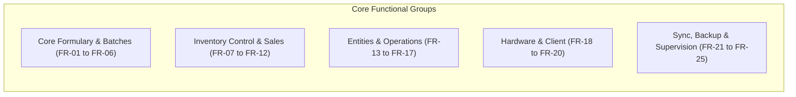
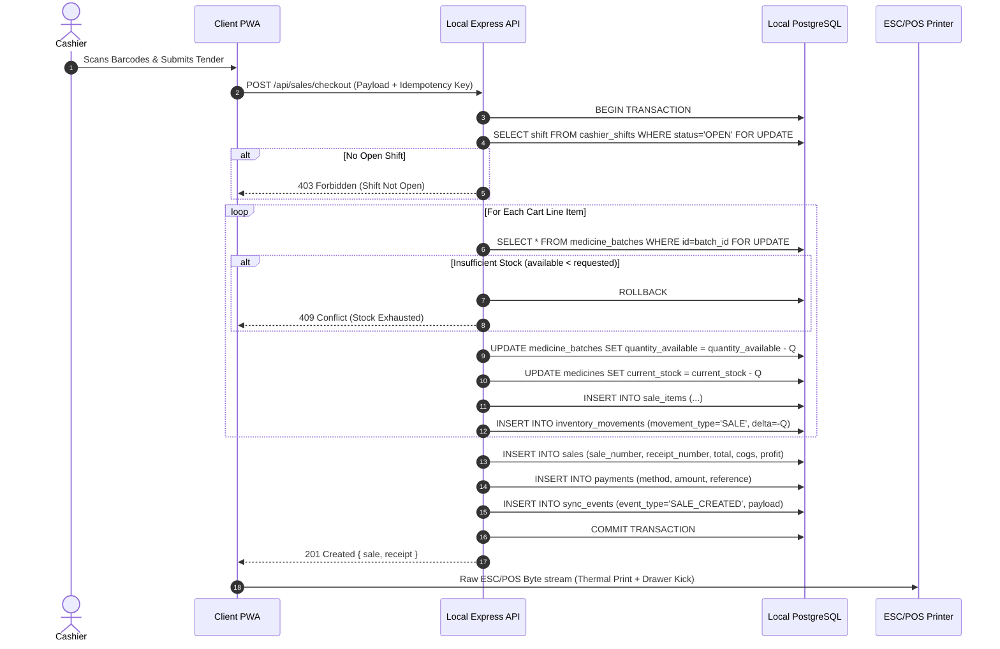
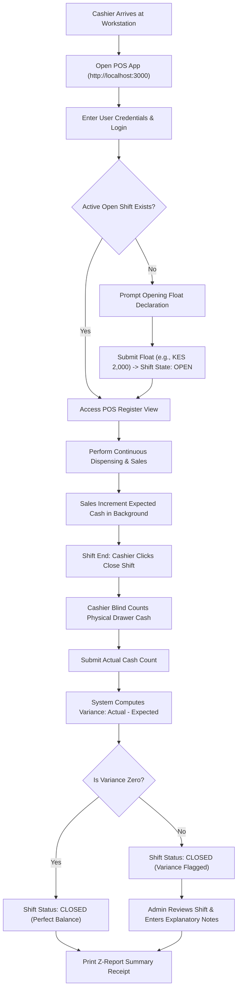
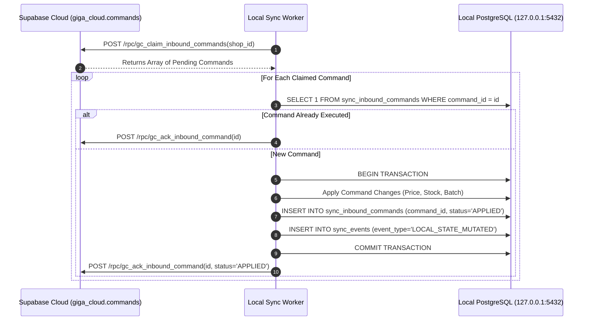

# Software Requirements Specification (SRS)
## GIGA CHEMIST — Local-Server & Hybrid Offline-First Pharmacy Management System

**Document Identifier:** GIGA-SRS-LOCAL-V1.5  
**Document Version:** 1.5.0 (Exhaustive Architectural Baseline)  
**Status:** Approved / Historical & Operational Standard  
**System Classification:** On-Premises Master Server + Local LAN Counter Terminals + Asynchronous Outbox Cloud Mirror  
**Repository:** `b:\GIGA-CHEMIST-POS`

---

## 1. Introduction

### 1.1 Purpose
This document provides an exhaustive, formal specification of the software requirements for the **GIGA CHEMIST Local-Server and Hybrid Offline-First Pharmacy System**. It establishes the complete architectural, functional, data, interface, and hardware requirements that governed the system when an **on-premises master PC** hosted the authoritative PostgreSQL database and application engine. 

### 1.2 Scope & Core Mandate
The primary mandate of the local-server system was **absolute operational autonomy under complete network isolation**:
1. **Zero-Internet Operational Continuity:** The pharmacy point of sale, dispensing workflows, cashier shifts, inventory adjustments, and physical receipt printing had to operate continuously without degradation, regardless of whether internet access was absent, intermittent, or unstable.
2. **Local PostgreSQL Authority:** The on-premises database (`127.0.0.1:5432`) was the single authoritative master for all inventory balances, batch records, user credentials, shifts, and financial ledgers.
3. **LAN Multi-Terminal Operation:** A single master server PC served multiple client counter terminals and tablet devices within the shop over the local area network (LAN).
4. **Hybrid Outbox Cloud Mirroring:** When internet connectivity was available, an asynchronous background worker synced committed transactions to Supabase Cloud (`giga_cloud.*`), maintained cryptographic inventory parity, and polled for remote administration commands.

### 1.3 Definitions, Acronyms, and Abbreviations
- **ACID:** Atomicity, Consistency, Isolation, Durability.
- **Advisory Lock:** A PostgreSQL session-level application lock (`pg_try_advisory_lock`) used to elect a single sync leader.
- **ATC:** Anatomical Therapeutic Chemical classification system.
- **COGS:** Cost of Goods Sold ($\text{Unit Cost} \times \text{Quantity Sold}$).
- **Dexie.js / IndexedDB:** The client-side browser object database caching formularies for sub-millisecond barcode scanning.
- **ESC/POS:** Standardized printer command language for thermal receipt printers.
- **FEFO:** First-Expired, First-Out (stock allocation prioritizing the earliest expiring pharmaceutical batch).
- **HID:** Human Interface Device (standard barcode scanner operating in keyboard emulation mode).
- **LAN:** Local Area Network (IPv4 private subnet, e.g., `192.168.1.0/24`).
- **Outbox Pattern:** Transactional design where state mutations and outgoing sync packets are written in the same atomic database transaction.
- **PWA:** Progressive Web Application.
- **RPC:** Remote Procedure Call (PostgreSQL database functions on Supabase).
- **UUIDv4:** Universally Unique Identifier (RFC 4122).
- **WAL:** Write-Ahead Logging.

---

## 2. Overall Description & System Architecture

### 2.1 Physical & Network Topology

```
┌────────────────────────────────────────────────────────────────────────────────────────┐
│                              PHARMACY PHYSICAL PREMISES                                │
│                                                                                        │
│   ┌────────────────────────────────────────────────────────────────────────────────┐   │
│   │ PRIMARY SERVER WORKSTATION (Windows 11 Pro 64-bit)                             │   │
│   │                                                                                │   │
│   │   [ Task Scheduler: GigaChemistPOS_Service ]                                  │   │
│   │        │                                                                       │   │
│   │        ▼                                                                       │   │
│   │   [ service-runner.ps1 / watchdog.ps1 ]                                        │   │
│   │        │                                                                       │   │
│   │        ├─► [ PostgreSQL 16 Service (127.0.0.1:5432) ]                          │   │
│   │        │    ├── Database: giga_chemist (Authoritative Master)                  │   │
│   │        │    └── Storage: Local NVMe SSD (WAL + Backups)                        │   │
│   │        │                                                                       │   │
│   │        ├─► [ Node.js 20 LTS Backend Engine (server.ts) ]                       │   │
│   │        │    ├── Express API: http://0.0.0.0:3000                               │   │
│   │        │    ├── Background Sync Worker (Advisory Lock: 7420317001)             │   │
│   │        │    ├── Automated Backup Daemon (server/ops/backup.ts)                 │   │
│   │        │    └── Local Email Queue (server/email/service.ts)                    │   │
│   │        │                                                                       │   │
│   │        └─► [ Primary Cashier Terminal PWA (http://localhost:3000) ]            │   │
│   │             ├── Hardware: USB Thermal Printer (ESC/POS 80mm)                   │   │
│   │             ├── Hardware: RJ11 Cash Drawer Kick (ESC p 0 25 250)               │   │
│   │             └── Hardware: USB Barcode Scanner (HID Keystroke Buffer)           │   │
│   └────────────────────────┬───────────────────────────────────────────────────────┘   │
│                            │ Private LAN Subnet (Ethernet / Wi-Fi Router)              │
│                            ▼                                                           │
│   ┌────────────────────────────────────────────────┐  ┌────────────────────────────┐   │
│   │ SECONDARY COUNTER TERMINAL (PC 2)              │  │ DISPENSARY TABLET (Wi-Fi)  │   │
│   │ - Browser PWA: http://192.168.1.100:3000       │  │ - Mobile PWA Browser       │   │
│   │ - Dexie IndexedDB In-Browser Cache             │  │ - Formulary Search         │   │
│   │ - Dedicated USB Barcode Scanner                │  │ - Physical Stock Counting  │   │
│   └────────────────────────────────────────────────┘  └────────────────────────────┘   │
└────────────────────────────────────┬───────────────────────────────────────────────────┘
                                     │ WAN / Internet Gateway (Optional & Asynchronous)
                                     ▼
┌────────────────────────────────────────────────────────────────────────────────────────┐
│                        SUPABASE CLOUD INFRASTRUCTURE                                   │
│                                                                                        │
│   ┌────────────────────────────────────────────────┐  ┌────────────────────────────┐   │
│   │ Supabase PostgreSQL Mirror (Port 6543)         │  │ Remote Admin Web Console   │   │
│   │ - Schema: giga_cloud.* (Replicated Mirror)     │  │ (Owner Laptop / Phone)     │   │
│   │ - Views: giga_online.*                         │  │                            │   │
│   │ - Outbox Destination: gc_apply_sync_events     │  │ - Views Mirror Reports     │   │
│   │ - Inbound Commands: giga_cloud.commands        │  │ - Queues Remote Changes    │   │
│   │ - Parity Verification: gc_get_inventory_finger │  │   (PENDING state)          │   │
│   │ - Self-Healing: gc_apply_inventory_snapshot    │  │                            │   │
│   └────────────────────────────────────────────────┘  └────────────────────────────┘   │
└────────────────────────────────────────────────────────────────────────────────────────┘
```

### 2.2 System Invariants & Architectural Rules
1. **Local Authoritative Rule:** No remote network request could block a cashier from completing a sale. Network requests could only be dispatched asynchronously in the background.
2. **Atomic Depletion Rule:** A sale and its inventory decrement occurred in the exact same database transaction as the corresponding `sync_events` outbox entry. A sale could never be committed without its outbox event.
3. **No Phantom Re-Hydration Rule:** The client browser cache (Dexie) was strictly an optimistic local cache. The local server's PostgreSQL commit was authoritative; if client-side IndexedDB drifted, a re-sync overwrote local IndexedDB with PostgreSQL records.
4. **Idempotent Inbound Execution:** Any command originating from the remote cloud application was tracked in `sync_inbound_commands` with a unique idempotency key. A delivered command could never be executed twice.

---

## 3. Exhaustive Functional Requirements



---

### FR-01: Local Server Initialization, Auto-Start & Service Supervision

#### Description
The local system must boot automatically on Windows 11 system power-on without requiring any user login, interactive terminal sessions, or manual script execution.

#### Technical Implementation & Scripts
- **Service Supervisor:** `deployment/windows/service-runner.ps1`
- **Watchdog Daemon:** `deployment/windows/watchdog.ps1`
- **Scheduled Task:** `GigaChemistPOS_Service` registered under `NT AUTHORITY\SYSTEM`.

#### Detailed Execution Sequence
1. **OS Boot Trigger:** Task Scheduler fires at system startup (`AtStartup` trigger) with highest administrative privileges.
2. **Port 3000 Singleton Check:** The runner checks if port 3000 is occupied (`Get-NetTCPConnection -LocalPort 3000`). If an orphaned process is detected, it terminates the process (`Stop-Process -Force`).
3. **Database Dependency Readiness Check:**
   - The runner polls `127.0.0.1:5432` using `Test-NetConnection` and executes `SELECT 1` via `psql`.
   - Loops with 2-second sleep intervals up to a hard timeout of 60 seconds.
   - If PostgreSQL fails to start, launches `repair-postgresql-service.ps1` and restarts the `postgresql-x64-16` service.
4. **Asset Verification:** Confirms that `dist/index.html` and bundled client assets exist.
5. **Process Spawning:** Spawns `node server.ts` with standard output redirected to `logs/server.log` and startup messages streamed to `logs/startup.log`.
6. **Crash Auto-Restart:** If the Node.js process exits with a non-zero exit code, Task Scheduler restarts the process up to 3 times within a 1-minute window.

---

### FR-02: User Authentication & Salted PBKDF2/Argon Verification

#### Description
Provides secure, local-only authentication. Cashiers and administrators authenticate against local database tables using username/email and password, or rapid 4-to-6 digit cashier PINs.

#### Database Entities
- `users`: `id`, `name`, `email`, `username`, `password_hash`, `pin_hash`, `salt`, `role`, `active`, `last_login`.
- `roles`: `ADMIN`, `MANAGER`, `CASHIER`.
- `permissions`: Individual granular rights (`sales.create`, `medicine.change_price`, `stock.receive`, etc.).

#### Endpoints
- `POST /api/auth/login`
- `GET /api/auth/me`

#### Step-by-Step Verification Sequence
1. Client submits `{ identifier: "cashier1", credential: "secretPasswordOrPin" }`.
2. Server queries `users` matching `email = identifier OR username = identifier`.
3. Verifies `active = true`. If inactive, rejects with HTTP 403 `ACCOUNT_DISABLED`.
4. Derives hash using stored cryptographic salt:
   - For passwords: HMAC-SHA256 / PBKDF2 iteration.
   - For PINs: dedicated salted PIN digest.
5. Performs constant-time buffer comparison (`crypto.timingSafeEqual`) to prevent timing side-channel attacks.
6. Upon successful verification:
   - Updates `last_login = CURRENT_TIMESTAMP`.
   - Generates signed JWT bearer token containing `userId`, `role`, `deviceId`, and 24-hour expiration.
   - Returns `{ token, user: { id, name, email, username, role, permissions } }`.

---

### FR-03: Centralized User Administration & Access Control

#### Description
Allows administrators to manage staff credentials, deactivate accounts, assign granular role permissions, and reset PINs locally.

#### Endpoints
- `GET /api/users`
- `POST /api/users`
- `PUT /api/users/:id`
- `PATCH /api/users/:id/role`
- `PATCH /api/users/:id/status`
- `POST /api/users/:id/pin`
- `POST /api/users/:id/reset-password`

#### Rules & Constraints
- Only users with role `ADMIN` may create or modify user profiles.
- Password and PIN hashes are generated using cryptographic random salts (`crypto.randomBytes(32)`).
- Deleting users is prohibited if referenced in sales or shift ledgers; accounts are soft-disabled (`active = false`).

---

### FR-04: Pharmaceutical Formulary & Medicine Master Catalog

#### Description
Maintains the authoritative pharmacy catalog. Manages brand names, generic formulations, SKU barcodes, prescription requirements, and clinical categories.

#### Database Entity
- `medicines`:
  ```sql
  id UUID PRIMARY KEY,
  name VARCHAR(255) NOT NULL,
  generic_name VARCHAR(255) NOT NULL,
  brand_name VARCHAR(255),
  sku VARCHAR(100) NOT NULL,
  barcode VARCHAR(100) NOT NULL,
  category_id UUID REFERENCES categories(id),
  dosage_strength VARCHAR(100) NOT NULL,
  dosage_form VARCHAR(100) NOT NULL,
  unit VARCHAR(50) DEFAULT 'Strips (10 tabs)',
  reorder_level INTEGER NOT NULL DEFAULT 20,
  prescription_required BOOLEAN DEFAULT FALSE,
  status VARCHAR(20) DEFAULT 'active',
  version INTEGER DEFAULT 1
  ```

#### Endpoints
- `GET /api/medicines`
- `POST /api/medicines`
- `PUT /api/medicines/:id`
- `POST /api/medicines/:id/delete-preflight`
- `DELETE /api/medicines/:id`
- `POST /api/medicines/:id/restore`

#### Delete Preflight Rule
Before deleting a medicine, the system executes an authoritative preflight query checking total physical stock across all active batches:
$$\text{Total Stock} = \sum \text{quantity\_available}$$
If $\text{Total Stock} > 0$, deletion is rejected with HTTP 409: `"Cannot delete medicine: item still has N units in stock"`. Zero-stock items are flagged `status = 'deleted'`.

---

### FR-05: Multi-Tier Pricing & Profit Margin Protection

#### Description
Controls the retail selling price, wholesale bulk price, purchase cost, and minimum selling price floor to protect pharmacy margins.

#### Endpoints
- `PATCH /api/medicines/:id/pricing`
- `GET /api/price-history`

#### Step-by-Step Update Sequence
1. Admin submits `{ selling_price, purchase_price, wholesale_price, min_selling_price, reorder_level }`.
2. Validates: $\text{selling\_price} \ge \text{min\_selling\_price} \ge 0$.
3. Checks margin warning: if $\text{selling\_price} < \text{purchase\_price}$, flags a negative margin warning.
4. Executes atomic update on `medicines` and increments `version = version + 1`.
5. Inserts an immutable row into `price_history` recording `previous_selling_price`, `new_selling_price`, `changed_by_user_id`, and `reason`.
6. Enqueues a `PRICE_UPDATED` event in `sync_events`.

---

### FR-06: Batch Tracking, FEFO Rotation & Expiry Management

#### Description
Manages distinct pharmaceutical manufacturing batches to ensure compliance with healthcare expiration regulations.

#### Database Entity
- `medicine_batches`:
  ```sql
  id UUID PRIMARY KEY,
  medicine_id UUID NOT NULL REFERENCES medicines(id),
  batch_number VARCHAR(100) NOT NULL,
  quantity_received INTEGER NOT NULL,
  quantity_available INTEGER NOT NULL CHECK (quantity_available >= 0),
  expiry_date DATE,
  manufacturing_date DATE,
  expiry_status VARCHAR(20) DEFAULT 'KNOWN',
  status VARCHAR(20) DEFAULT 'active'
  ```

#### Endpoints
- `GET /api/batches`
- `PATCH /api/batches/:id/expiry`

#### FEFO Business Rules
- **Status Classification:**
  - $\text{expiry\_date} < \text{today} \implies \text{EXPIRED}$ (Disallowed from checkout selection).
  - $\text{expiry\_date} \le \text{today} + 90\text{ days} \implies \text{EXPIRING\_SOON}$ (Visual amber warning).
  - $\text{expiry\_date} > \text{today} + 90\text{ days} \implies \text{VALID}$ (Green indicator).
- When dispensing, batches are presented in strict ascending order of expiry date (earliest expiry first).

---

### FR-07: Real-Time Inventory Control & Direct Stock Adjustments

#### Description
Enables authorized administrators to perform manual stock corrections (damage, loss, expired write-offs, physical adjustments) with mandatory audit logging.

#### Endpoints
- `POST /api/inventory/set-stock` (Sets exact absolute quantity)
- `POST /api/inventory/add-stock` (Increments quantity)
- `POST /api/inventory/remove-stock` (Decrements quantity with zero floor)
- `GET /api/inventory/movements`

#### Step-by-Step Execution Sequence (`set-stock`)
1. Accepts `{ medicine_id, batch_id, new_stock, reason, notes }`.
2. Opens database transaction (`BEGIN`).
3. Fetches target row with row-level lock (`SELECT ... FOR UPDATE`).
4. Calculates delta: $\Delta = \text{new\_stock} - \text{current\_quantity}$.
5. Updates `medicine_batches.quantity_available = new_stock`.
6. Recalculates total `medicines.current_stock = SUM(quantity_available)`.
7. Inserts row into `inventory_movements`:
   - `previous_quantity`, `adjustment_quantity = delta`, `new_quantity = new_stock`.
   - `movement_type = 'ADJUSTMENT'`, `reason`, `user_id`, `device_id`.
8. Inserts row into `sync_events` with `event_type = 'STOCK_ADJUSTED'`.
9. Commits transaction (`COMMIT`).

---

### FR-08: Inventory Intelligence & Automated Reorder Suggestions

#### Description
Calculates stock depletion rates and generates automated purchase order drafts for fast-moving and depleted inventory.

#### Endpoints
- `GET /api/inventory/insights/fast-moving`
- `GET /api/inventory/insights/slow-moving`
- `GET /api/inventory/insights/dead-stock`
- `GET /api/inventory/insights/reorder`
- `POST /api/purchases/drafts`

#### Calculation Algorithms
- **Consumption Velocity:** $V = \frac{\sum \text{Quantity Sold past 30 days}}{30\text{ days}}$.
- **Days of Stock Remaining:** $D = \frac{\text{Current Stock}}{V}$.
- **Reorder Threshold:** Triggered when $\text{Current Stock} \le \text{reorder\_level}$.
- **Suggested Order Quantity:** $Q = \text{reorder\_level} \times 2 - \text{Current Stock}$.

---

### FR-09: Point of Sale Checkout & Atomic Transaction Depletion

#### Description
The core dispensing transaction engine. Assembles cart lines, validates cashier shift status, decrements physical stock, captures split tenders, logs taxes and COGS, and generates receipts.

#### Database Entities
- `sales`, `sale_items`, `payments`, `inventory_movements`, `sync_events`.

#### Endpoints
- `POST /api/sales/checkout`
- `GET /api/sales/today-summary`

#### Complete Step-by-Step Checkout Protocol



---

### FR-10: Sales Voiding & Restocking Protocol

#### Description
Enables an administrator to void a mistakenly entered or fraudulent sale, reversing financial totals and returning items to stock.

#### Endpoints
- `POST /api/sales/:id/void`

#### Rules & Workflow
1. Verifies caller role is `ADMIN`.
2. Validates sale status: only `completed` sales can be voided.
3. Opens transaction (`BEGIN`).
4. Updates `sales.status = 'voided'`, sets `void_reason = reason`, `voided_by = admin_id`.
5. For each item in `sale_items`:
   - Increments `medicine_batches.quantity_available = quantity_available + item.quantity`.
   - Increments `medicines.current_stock = current_stock + item.quantity`.
   - Records `inventory_movements` row with `movement_type = 'CORRECTION'`, `delta = +item.quantity`.
6. Enqueues `SALE_VOIDED` event in `sync_events`.
7. Commits transaction (`COMMIT`).

---

### FR-11: Cashier Shift Management, Till Tracking & Cash Variance

#### Description
Enforces strict cash control by tracking shift opening floats, continuous cash sales, cash refunds, manual pay-outs, and cash variances.

#### Database Entity
- `cashier_shifts`:
  ```sql
  shift_id UUID PRIMARY KEY,
  shift_number VARCHAR(50) UNIQUE NOT NULL,
  cashier_id UUID NOT NULL REFERENCES users(id),
  cashier_name VARCHAR(255) NOT NULL,
  opened_at TIMESTAMPTZ NOT NULL,
  opening_float NUMERIC(12,2) NOT NULL,
  expected_cash NUMERIC(12,2) DEFAULT 0.00,
  actual_cash NUMERIC(12,2),
  cash_variance NUMERIC(12,2),
  status VARCHAR(20) DEFAULT 'OPEN' CHECK (status IN ('OPEN', 'CLOSED', 'REVIEWED'))
  ```

#### Endpoints
- `GET /api/shifts/current`
- `POST /api/shifts/open`
- `POST /api/shifts/:id/close`
- `POST /api/shifts/:id/review`
- `POST /api/shifts/:id/corrections`

#### Variance Formula
$$\text{Expected Cash} = \text{Opening Float} + \text{Cash Sales} - \text{Cash Refunds} - \text{Cash Expenses}$$
$$\text{Cash Variance} = \text{Actual Cash Counted} - \text{Expected Cash}$$
- $\text{Variance} = 0 \implies \text{Balanced Till}$.
- $\text{Variance} < 0 \implies \text{Cash Shortage (Flagged for Review)}$.
- $\text{Variance} > 0 \implies \text{Cash Overage}$.

---

### FR-12: Formal Stocktake Sessions & Discrepancy Reconciliation

#### Description
Conducts periodic physical stocktakes without halting dispensary operations. Allows blind counting by staff, discrepancy calculation, and administrative approval.

#### Endpoints
- `POST /api/stocktakes` (Creates stocktake session)
- `POST /api/stocktakes/:id/start` (Locks snapshot baseline)
- `PUT /api/stocktakes/:id/lines/:lineId` (Enters physical count)
- `POST /api/stocktakes/:id/submit` (Submits for managerial review)
- `POST /api/stocktakes/:id/approve` (Applies physical adjustments to inventory)
- `POST /api/stocktakes/:id/cancel`

#### Reconciliation Math
$$\text{Discrepancy} = \text{Counted Quantity} - \text{System Expected Quantity}$$
Upon approval, the system generates automated `inventory_movements` rows for each line where $\text{Discrepancy} \neq 0$ and updates `medicine_batches` accordingly.

---

### FR-13: Customer Directory & Store Credit Ledger

#### Description
Maintains patient records, allergy and clinical notes, and tracks outstanding store credit accounts for chronic medication dispensing.

#### Database Entity
- `customers`: `id`, `name`, `phone`, `email`, `address`, `notes`, `credit_balance`, `total_spent`, `last_visit`.

#### Endpoints
- `GET /api/customers`
- `POST /api/customers`
- `POST /api/customers/:id/active`

---

### FR-14: Supplier Directory & Purchase Order Receiving

#### Description
Manages pharmaceutical distributors, wholesale invoices, purchase orders, and automatic batch restock ingestion.

#### Endpoints
- `GET /api/suppliers`
- `POST /api/suppliers`
- `GET /api/purchases`
- `POST /api/purchases` (Receives order and creates new batches)

#### Restock Ingestion Protocol
1. Admin enters invoice number, supplier, and received lines (medicine, batch number, expiry date, quantity, cost price).
2. For each line, checks if `(medicine_id, batch_number)` exists in `medicine_batches`:
   - If exists: increments `quantity_received` and `quantity_available`.
   - If new: inserts new batch record with calculated expiry status.
3. Updates `medicines.current_stock` and latest `purchase_price`.
4. Creates `inventory_movements` record with `movement_type = 'PURCHASE'`.
5. Enqueues `PURCHASE_RECEIVED` in `sync_events`.

---

### FR-15: Customer Returns Management & Inspection Workflow

#### Description
Handles customer drug return requests with mandatory quarantine/restock action flags, refund calculations, and administrator approval.

#### Endpoints
- `GET /api/returns`
- `POST /api/returns` (Submits request by cashier)
- `POST /api/returns/:id/approve` (Admin review: restock or discard)
- `POST /api/returns/:id/reject`

---

### FR-16: Operational Overhead & Expense Tracking

#### Description
Logs petty cash payments and pharmacy operational costs (rent, electricity, delivery fees, packaging), optionally deducting directly from the open till drawer.

#### Endpoints
- `GET /api/expenses`
- `POST /api/expenses`
- `POST /api/expenses/:id/void`

---

### FR-17: Business Day Summary & Financial Reporting

#### Description
Provides server-side aggregations for revenue, tax, COGS, gross margins, payment method splits, and hourly dispensing trends directly from PostgreSQL.

#### Endpoints
- `GET /api/reports/summary`
- `GET /api/business-day`
- `GET /api/history/sales`
- `GET /api/history/stock`

---

### FR-18: Local Hardware Peripherals — ESC/POS Thermal Printing & Cash Drawer

#### Description
Direct hardware control for thermal receipt printers (58mm / 80mm) via Windows spooler or USB/serial connections without OS print dialogues.

#### Technical Specifications
- **Receipt Template:**
  - Header: Pharmacy Name, Tagline, Address, Phone, KRA Tax PIN.
  - Receipt Number, Sale Number, Date, Time, Cashier Name.
  - Line items: Name, Quantity, Unit Price, Total.
  - Summary: Subtotal, Discount, Tax, Grand Total, Tender Breakdown.
  - Barcode / QR Code containing receipt number.
  - Footer: Prescription advice and get-well message.
- **Drawer Kick Command:** Sends binary pulse sequence `0x1B, 0x70, 0x00, 0x19, 0xFA` to kick the cash drawer solenoid on cash checkout.

---

### FR-19: Barcode Scanner Input Handling & Buffer Emulation

#### Description
Captures input from 1D/2D USB and Bluetooth barcode scanners without requiring the user to click into a text input field.

#### Implementation
- Global window listener captures `keydown` events.
- Evaluates inter-character delay: scanner bursts deliver characters at $<30\text{ms}$ intervals followed by `Enter` (`0x0D`).
- Automatically directs scanner bursts to cart item lookup, bypassing active search input fields.

---

### FR-20: Offline-First Dexie IndexedDB In-Browser Engine

#### Description
Caches catalog datasets in browser storage for instant navigation, search, and resilient cart handling.

#### Stores in IndexedDB (`GigaChemistDB`)
- `medicines`, `medicine_batches`, `categories`, `customers`, `suppliers`, `expenses`, `held_sales`, `settings`.

---

### FR-21: Transactional Outbox Pattern & Background Sync Worker

#### Description
Asynchronously delivers committed operational events from the local database to the remote Supabase Cloud.

#### Execution Architecture
```sql
-- Draining due events
SELECT * FROM sync_events
WHERE status = 'PENDING' AND next_attempt_at <= CURRENT_TIMESTAMP
ORDER BY seq ASC
LIMIT 50
FOR UPDATE SKIP LOCKED;
```

#### Backoff Algorithm
$$\text{Next Delay} = \min(300\text{s}, 5\text{s} \times 2^{\text{attempt\_count}})$$
Transient network errors increment `attempt_count` and reschedule `next_attempt_at`.

---

### FR-22: Inbound Cloud Command Execution & Idempotency Replay

#### Description
Executes remote configuration, catalog, and stock commands issued from the cloud by the remote administrator.

#### Polling & Execution Sequence
1. Sync worker queries cloud RPC `gc_claim_inbound_commands(shop_id)`.
2. For each claimed command:
   - Checks `sync_inbound_commands` by `idempotency_key`.
   - If already recorded: acknowledges immediately (`gc_ack_inbound_command`).
   - If new: executes command locally inside a PostgreSQL transaction (`BEGIN ... COMMIT`).
   - Records result and status `APPLIED` or `REJECTED`.
   - Sends acknowledgment back to cloud.

---

### FR-23: Authoritative Inventory Fingerprint & Self-Healing Mirror

#### Description
Maintains absolute mathematical parity between the local server inventory and the cloud read-only mirror.

#### Reconciliation Sequence
1. Local server computes SHA-256 fingerprint of all `(medicine_id, current_stock, batch_id, quantity_available)`.
2. Compares with cloud fingerprint returned by `gc_get_inventory_fingerprint`.
3. If fingerprints match: inventory is in 100% parity; no action taken.
4. If fingerprints diverge: local server generates complete authoritative snapshot and calls `gc_apply_inventory_snapshot`, overwriting cloud mirror discrepancies.

---

### FR-24: Telemetry Heartbeats, Machine Health & Local Alert Center

#### Description
Monitors local machine health and alerts administrators to low disk space, unacknowledged commands, or database degradation.

#### Telemetry Payload
- Storage: Free disk space on `C:\` (alerts if $<2\text{ GB}$).
- Database: Active connection count, lock wait times.
- Outbox: Count of `PENDING` events and oldest un-synced timestamp.
- Uptime: System uptime in seconds.

---

### FR-25: Automated Database Backups, Restore Drills & Retention Daemon

#### Description
Automated scheduled backups of the local PostgreSQL database using native `pg_dump` with retention management.

#### Retention Schedule
- Daily backups retained for 14 days (`BACKUP_KEEP = 14`).
- Weekly backups retained for 8 weeks (`BACKUP_KEEP_WEEKLY = 8`).
- Backups older than the retention threshold are automatically deleted to prevent disk overflow.

---

## 4. External Interface Specifications

### 4.1 LAN Networking & Firewall Rules
- **Express Backend:** Binds to `0.0.0.0:3000`.
- **PostgreSQL Database:** Binds strictly to `127.0.0.1:5432` (prohibited from listening on public interfaces).
- **Windows Firewall:** Configured with an inbound rule allowing TCP traffic on port 3000 only from the local subnet (`Private` network profile).

### 4.2 Hardware Peripherals
- **Printers:** Direct raw text and ESC/POS byte streaming via Windows spooler API or node USB.
- **Cash Drawers:** Standard 24V RJ11/RJ12 drawer interface triggered via receipt printer.
- **Barcode Scanners:** USB Type-A / Type-C HID Keyboard Emulation.

---

## 5. Non-Functional Requirements

### 5.1 Zero-Internet Resilience
- The system must experience **zero downtime or blocked checkouts** when internet connectivity is completely lost for indefinite periods.

### 5.2 Performance & Responsiveness
- **Barcode Search Latency:** $<10\text{ms}$ via IndexedDB.
- **Checkout Transaction Commit:** $<80\text{ms}$ on local PostgreSQL SSD.

### 5.3 Data Durability & Power Loss Protection
- Local PostgreSQL configured with `synchronous_commit = on` and `fsync = on`.
- In the event of sudden power loss, WAL replay recovers the database to a consistent state with zero transaction corruption.

---

## 6. End-to-End Workflow Diagrams

### 6.1 Complete Cashier Shift & Day-End Balancing Protocol



### 6.2 Cloud Command Polling & Idempotent Local Execution



---

## 7. Architectural Comparison Matrix

| Feature Dimension | Legacy Local-Server System | Modern Cloud-Only System |
| :--- | :--- | :--- |
| **Authoritative Store** | Local PostgreSQL (`127.0.0.1:5432`) | Supabase Cloud PostgreSQL (`giga_cloud.*`) |
| **Server Hardware** | On-site PC required | Zero server hardware (Browser / Mobile / Tablet) |
| **Offline Checkouts** | 100% autonomous operation | Requires active internet connection |
| **Multi-Terminal Sync** | Sub-millisecond across LAN | Sub-second via Supabase Realtime WebSockets |
| **Data Propagation** | Asynchronous transactional outbox | Synchronous direct cloud REST writes |
| **Hardware Peripherals** | Direct local ESC/POS & cash drawer | WebUSB / WebBluetooth / Browser print |
| **Admin Operations** | Inbound command queue with worker poll | Immediate REST bridge writes to cloud tables |
| **Maintenance Burden** | Windows Task Scheduler, scripts, `pg_dump` | Zero maintenance, managed serverless cloud |
