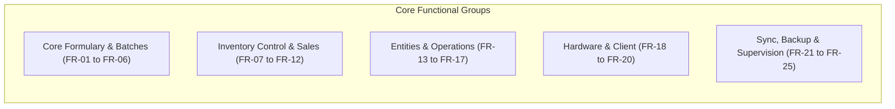
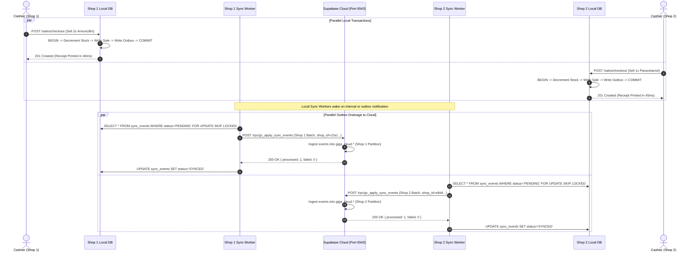
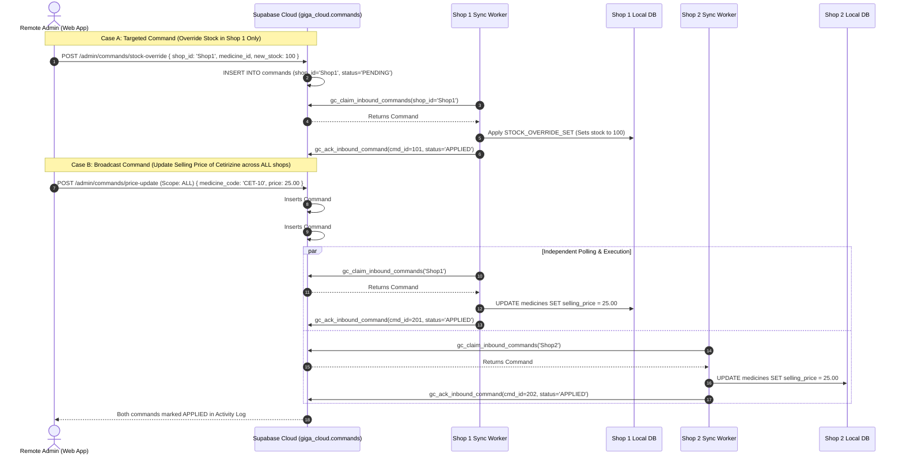
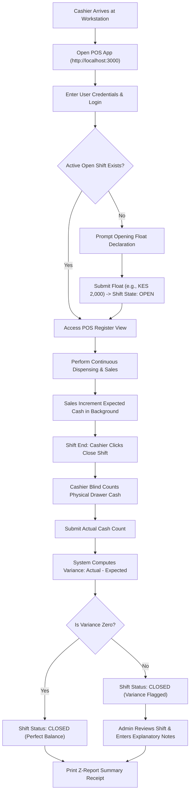

# Software Requirements Specification (SRS)
## GIGA CHEMIST — Local-Server & Hybrid Offline-First Pharmacy Management System

**Document Identifier:** GIGA-SRS-LOCAL-V1.5  
**Document Version:** 1.5.0 (Exhaustive Architectural Baseline with Multi-Shop & Local-to-Cloud Workflows)  
**Status:** Approved / Historical & Operational Standard  
**System Classification:** On-Premises Master Server + Local LAN Counter Terminals + Asynchronous Outbox Cloud Mirror  
**Repository:** `b:\GIGA-CHEMIST-POS`

---

## 1. Introduction

### 1.1 Purpose
This document provides an exhaustive, formal specification of the software requirements for the **GIGA CHEMIST Local-Server and Hybrid Offline-First Pharmacy System**. It establishes the complete architectural, functional, data, interface, hardware, and multi-branch requirements that governed the system when an **on-premises master PC per pharmacy branch** hosted the authoritative PostgreSQL database and application engine.

### 1.2 Scope & Core Mandate
The primary mandate of the local-server system was **absolute operational autonomy under complete network isolation**:
1. **Zero-Internet Operational Continuity:** The pharmacy point of sale, dispensing workflows, cashier shifts, inventory adjustments, and physical receipt printing had to operate continuously without degradation, regardless of whether internet access was absent, intermittent, or unstable.
2. **Local PostgreSQL Authority:** The on-premises database (`127.0.0.1:5432`) was the single authoritative master for all inventory balances, batch records, user credentials, shifts, and financial ledgers within each physical shop.
3. **LAN Multi-Terminal Operation:** A single master server PC served multiple client counter terminals and tablet devices within the shop over the local area network (LAN).
4. **Hybrid Outbox Cloud Mirroring:** When internet connectivity was available, an asynchronous background worker synced committed transactions to Supabase Cloud (`giga_cloud.*`), maintained cryptographic inventory parity, and polled for remote administration commands.
5. **Multi-Branch Multi-Shop Isolation:** Multiple independent physical branches (Shop 1, Shop 2) operated autonomously on their own local servers while synchronizing to a unified cloud database strictly partitioned by `shop_id`.

### 1.3 Definitions, Acronyms, and Abbreviations
- **ACID:** Atomicity, Consistency, Isolation, Durability.
- **Advisory Lock:** A PostgreSQL session-level application lock (`pg_try_advisory_lock`) used to elect a single sync leader.
- **ATC:** Anatomical Therapeutic Chemical classification system.
- **COGS:** Cost of Goods Sold ($\text{Unit Cost} \times \text{Quantity Sold}$).
- **Dexie.js / IndexedDB:** The client-side browser object database caching formularies for sub-millisecond barcode scanning.
- **ESC/POS:** Standardized printer command language for thermal receipt printers.
- **FEFO:** First-Expired, First-Out (stock allocation prioritizing the earliest expiring pharmaceutical batch).
- **HID:** Human Interface Device (standard barcode scanner operating in keyboard emulation mode).
- **LAN:** Local Area Network (IPv4 private subnet, e.g., `192.168.1.0/24`).
- **Outbox Pattern:** Transactional design where state mutations and outgoing sync packets are written in the same atomic database transaction.
- **PWA:** Progressive Web Application.
- **RPC:** Remote Procedure Call (PostgreSQL database functions on Supabase).
- **UUIDv4:** Universally Unique Identifier (RFC 4122).
- **WAL:** Write-Ahead Logging.

---

## 2. Overall Description & System Architecture

### 2.1 Multi-Shop Physical & Cloud Topology

```
┌────────────────────────────────────────────────────────────────────────────────────────┐
│                              PHARMACY PHYSICAL PREMISES                                │
│                                                                                        │
│   ┌────────────────────────────────────────────────────────────────────────────────┐   │
│   │ PRIMARY SERVER WORKSTATION (Windows 11 Pro 64-bit)                             │   │
│   │                                                                                │   │
│   │   [ Task Scheduler: GigaChemistPOS_Service ]                                  │   │
│   │        │                                                                       │   │
│   │        ▼                                                                       │   │
│   │   [ service-runner.ps1 / watchdog.ps1 ]                                        │   │
│   │        │                                                                       │   │
│   │        ├─► [ PostgreSQL 16 Service (127.0.0.1:5432) ]                          │   │
│   │        │    ├── Database: giga_chemist (Authoritative Master)                  │   │
│   │        │    └── Storage: Local NVMe SSD (WAL + Backups)                        │   │
│   │        │                                                                       │   │
│   │        ├─► [ Node.js 20 LTS Backend Engine (server.ts) ]                       │   │
│   │        │    ├── Express API: http://0.0.0.0:3000                               │   │
│   │        │    ├── Background Sync Worker (Advisory Lock: 7420317001)             │   │
│   │        │    ├── Automated Backup Daemon (server/ops/backup.ts)                 │   │
│   │        │    └── Local Email Queue (server/email/service.ts)                    │   │
│   │        │                                                                       │   │
│   │        └─► [ Primary Cashier Terminal PWA (http://localhost:3000) ]            │   │
│   │             ├── Hardware: USB Thermal Printer (ESC/POS 80mm)                   │   │
│   │             ├── Hardware: RJ11 Cash Drawer Kick (ESC p 0 25 250)               │   │
│   │             └── Hardware: USB Barcode Scanner (HID Keystroke Buffer)           │   │
│   └────────────────────────┬───────────────────────────────────────────────────────┘   │
│                            │ Private LAN Subnet (Ethernet / Wi-Fi Router)              │
│                            ▼                                                           │
│   ┌────────────────────────────────────────────────┐  ┌────────────────────────────┐   │
│   │ SECONDARY COUNTER TERMINAL (PC 2)              │  │ DISPENSARY TABLET (Wi-Fi)  │   │
│   │ - Browser PWA: http://192.168.1.100:3000       │  │ - Mobile PWA Browser       │   │
│   │ - Dexie IndexedDB In-Browser Cache             │  │ - Formulary Search         │   │
│   │ - Dedicated USB Barcode Scanner                │  │ - Physical Stock Counting  │   │
│   └────────────────────────────────────────────────┘  └────────────────────────────┘   │
└────────────────────────────────────┬───────────────────────────────────────────────────┘
                                     │ WAN / Internet Gateway (Optional & Asynchronous)
                                     ▼
┌────────────────────────────────────────────────────────────────────────────────────────┐
│                        SUPABASE CLOUD INFRASTRUCTURE                                   │
│                                                                                        │
│   ┌────────────────────────────────────────────────┐  ┌────────────────────────────┐   │
│   │ Supabase PostgreSQL Mirror (Port 6543)         │  │ Remote Admin Web Console   │   │
│   │ - Schema: giga_cloud.* (Replicated Mirror)     │  │ (Owner Laptop / Phone)     │   │
│   │ - Views: giga_online.*                         │  │                            │   │
│   │ - Outbox Destination: gc_apply_sync_events     │  │ - Views Mirror Reports     │   │
│   │ - Inbound Commands: giga_cloud.commands        │  │ - Queues Remote Changes    │   │
│   │ - Parity Verification: gc_get_inventory_finger │  │   (PENDING state)          │   │
│   │ - Self-Healing: gc_apply_inventory_snapshot    │  │                            │   │
│   └────────────────────────────────────────────────┘  └────────────────────────────┘   │
└────────────────────────────────────────────────────────────────────────────────────────┘
```

### 2.2 System Invariants & Architectural Rules
1. **Local Authoritative Rule:** No remote network request could block a cashier from completing a sale. Network requests could only be dispatched asynchronously in the background.
2. **Atomic Depletion Rule:** A sale and its inventory decrement occurred in the exact same database transaction as the corresponding `sync_events` outbox entry. A sale could never be committed without its outbox event.
3. **No Phantom Re-Hydration Rule:** The client browser cache (Dexie) was strictly an optimistic local cache. The local server's PostgreSQL commit was authoritative; if client-side IndexedDB drifted, a re-sync overwrote local IndexedDB with PostgreSQL records.
4. **Idempotent Inbound Execution:** Any command originating from the remote cloud application was tracked in `sync_inbound_commands` with a unique idempotency key. A delivered command could never be executed twice.
5. **Shop Isolation Guard Rule:** Under no circumstances could Shop 1 and Shop 2 cross-contaminate their local databases. Local database connection configurations (`giga_chemist` vs. `giga_chemist_shop2`) were strictly tied to their registered `SHOP_ID` and verified during server boot.

---

## 3. Exhaustive Functional Requirements



---

### FR-01: Local Server Initialization, Auto-Start & Service Supervision
- **Implementation:** `deployment/windows/service-runner.ps1`, `watchdog.ps1`, Task Scheduler `GigaChemistPOS_Service`.
- **Startup Protocol:**
  1. Boot trigger starts without user login.
  2. Singleton guard terminates any duplicate process on port 3000.
  3. Database readiness loop polls `127.0.0.1:5432` up to 60s, restarting PostgreSQL if unresponsive.
  4. Verifies production web bundle (`dist/index.html`).
  5. Launches `server.ts` with output streamed to `logs/server.log`.

### FR-02: User Authentication & Salted PBKDF2/PIN Verification
- **Endpoints:** `POST /api/auth/login`, `GET /api/auth/me`.
- **Entities:** `users` (`password_hash`, `pin_hash`, `salt`, `role`, `active`).
- **Protocol:** Constant-time buffer comparison (`crypto.timingSafeEqual`) on derived cryptographic salts; returns signed JWT bearer token (24-hour expiration).

### FR-03: Centralized User Administration & Access Control
- **Endpoints:** `GET /api/users`, `POST /api/users`, `PUT /api/users/:id`, `PATCH /api/users/:id/role`, `PATCH /api/users/:id/status`, `POST /api/users/:id/pin`.
- **Rules:** Admin role required; passwords/PINs salted with `crypto.randomBytes(32)`; soft deactivation (`active = false`).

### FR-04: Pharmaceutical Formulary & Medicine Master Catalog
- **Endpoints:** `GET /api/medicines`, `POST /api/medicines`, `PUT /api/medicines/:id`, `POST /api/medicines/:id/delete-preflight`, `DELETE /api/medicines/:id`.
- **Preflight Rule:** Deletion rejected with HTTP 409 if active physical batch stock $> 0$.

### FR-05: Multi-Tier Pricing & Profit Margin Protection
- **Endpoints:** `PATCH /api/medicines/:id/pricing`, `GET /api/price-history`.
- **Fields:** `selling_price`, `purchase_price`, `wholesale_price`, `min_selling_price`.
- **Protocol:** Enforces $\text{selling\_price} \ge \text{min\_selling\_price}$; logs historical changes into `price_history`.

### FR-06: Batch Tracking, FEFO Rotation & Expiry Management
- **Endpoints:** `GET /api/batches`, `PATCH /api/batches/:id/expiry`.
- **FEFO Protocol:** Batches categorized as `VALID` (>90 days), `EXPIRING_SOON` ($\le$90 days), or `EXPIRED` ($<\text{today}$). Cart automatically allocates earliest-expiring batch.

### FR-07: Real-Time Inventory Control & Direct Stock Adjustments
- **Endpoints:** `POST /api/inventory/set-stock`, `POST /api/inventory/add-stock`, `POST /api/inventory/remove-stock`, `GET /api/inventory/movements`.
- **Protocol:** Row-level locks (`SELECT ... FOR UPDATE`), calculates delta, updates batch and medicine stock, inserts immutable record into `inventory_movements` and `sync_events`.

### FR-08: Inventory Intelligence & Automated Reorder Suggestions
- **Endpoints:** `GET /api/inventory/insights/fast-moving`, `slow-moving`, `dead-stock`, `reorder`, `POST /api/purchases/drafts`.
- **Math:** Consumption velocity $V = \frac{\sum Q_{30}}{30}$; triggers reorder when $\text{Stock} \le \text{reorder\_level}$; suggested order $Q = 2 \times \text{reorder\_level} - \text{Stock}$.

### FR-09: Point of Sale Checkout & Atomic Transaction Depletion
- **Endpoints:** `POST /api/sales/checkout`, `GET /api/sales/today-summary`.
- **Protocol:** Enforces active open shift; row-level lock on batches; decrements stock; records sale, sale items, payments (Cash/MPesa/Card/Split), movement ledger, and outbox event in one single atomic transaction.

### FR-10: Sales Voiding & Restocking Protocol
- **Endpoints:** `POST /api/sales/:id/void`.
- **Protocol:** Admin authorization required; marks sale voided with reason; returns quantities back to original batches; writes restorative movement entries.

### FR-11: Cashier Shift Management, Till Tracking & Cash Variance
- **Endpoints:** `GET /api/shifts/current`, `POST /api/shifts/open`, `POST /api/shifts/:id/close`, `POST /api/shifts/:id/review`.
- **Variance Math:** $\text{Expected} = \text{Float} + \text{Cash Sales} - \text{Refunds} - \text{Expenses}$; $\text{Variance} = \text{Actual} - \text{Expected}$.

### FR-12: Formal Stocktake Sessions & Discrepancy Reconciliation
- **Endpoints:** `POST /api/stocktakes`, `POST /api/stocktakes/:id/start`, `PUT /api/stocktakes/:id/lines/:lineId`, `POST /api/stocktakes/:id/submit`, `POST /api/stocktakes/:id/approve`.
- **Protocol:** Freezes baseline snapshot; allows blind counts; computes discrepancy ($\text{Count} - \text{Expected}$); applies adjustments on approval.

### FR-13: Customer Directory & Store Credit Ledger
- **Endpoints:** `GET /api/customers`, `POST /api/customers`, `POST /api/customers/:id/active`.
- **Capabilities:** Manages chronic care profiles, clinical notes, and tracks outstanding credit balances.

### FR-14: Supplier Directory & Purchase Order Ingestion
- **Endpoints:** `GET /api/suppliers`, `POST /api/suppliers`, `GET /api/purchases`, `POST /api/purchases`.
- **Protocol:** Receives supplier invoices; auto-creates or increments batches; updates cost price snapshots and total stock.

### FR-15: Customer Returns Management & Inspection Workflow
- **Endpoints:** `GET /api/returns`, `POST /api/returns`, `POST /api/returns/:id/approve`, `POST /api/returns/:id/reject`.
- **Protocol:** Cashier submits request; Admin inspects goods and designates action (`return_to_stock`, `quarantine`, `damaged`, `dispose`).

### FR-16: Operational Overhead & Expense Tracking
- **Endpoints:** `GET /api/expenses`, `POST /api/expenses`, `POST /api/expenses/:id/void`.
- **Protocol:** Records store overheads; optionally links cash outlays directly to the active shift till drawer.

### FR-17: Business Day Summary & Financial Reporting
- **Endpoints:** `GET /api/reports/summary`, `GET /api/business-day`, `GET /api/history/sales`, `GET /api/history/stock`.
- **Metrics:** Server-side aggregation of Revenue, Tax, Cost of Goods Sold, Gross Profit, and Payment Channel breakdowns.

### FR-18: Local Hardware Peripherals — ESC/POS Thermal Printing & Cash Drawer
- **Interface:** Raw byte streaming to 58mm/80mm USB thermal printers.
- **Drawer Kick:** Dispatches pulse sequence `0x1B, 0x70, 0x00, 0x19, 0xFA` upon cash tender finalization.

### FR-19: Barcode Scanner Input Handling & Buffer Emulation
- **Interface:** Global keystroke listener capturing HID keyboard emulation bursts ($<30\text{ms}$ per character) directly into cart lookup.

### FR-20: Offline-First Dexie IndexedDB In-Browser Engine
- **Engine:** 15 Dexie.js object stores caching formularies for $<10\text{ms}$ lookup speed and UI reactivity.

### FR-21: Transactional Outbox Pattern & Background Sync Worker
- **Table:** `sync_events` (`seq`, `event_type`, `payload`, `status = 'PENDING'`).
- **Protocol:** Session advisory lock `7420317001` elects single leader; claims batch of 50 via `FOR UPDATE SKIP LOCKED`; uploads via HTTPS RPC `gc_apply_sync_events` with exponential backoff.

### FR-22: Inbound Cloud Command Execution & Idempotency Replay
- **Table:** `sync_inbound_commands` (`command_id`, `idempotency_key`, `status`).
- **Protocol:** Worker claims commands via `gc_claim_inbound_commands`; checks idempotency; executes locally inside transaction; sends ACK to cloud.

### FR-23: Authoritative Inventory Fingerprint & Self-Healing Mirror
- **Protocol:** Every 120s computes SHA-256 hash of entire stock state; compares with cloud; publishes full snapshot (`gc_apply_inventory_snapshot`) if hash diverges.

### FR-24: Telemetry Heartbeats, Machine Health & Local Alert Center
- **Endpoints:** `/api/alerts`, `/api/admin/health`.
- **Payload:** Disk space ($>2\text{GB}$ free guard), memory, database connections, outbox backlog, uptime.

### FR-25: Automated Database Backups, Restore Drills & Retention Daemon
- **Module:** `server/ops/backup.ts`.
- **Schedule:** Automated `pg_dump` daily at 23:00; retention: 14 daily backups (`BACKUP_KEEP=14`), 8 weekly backups (`BACKUP_KEEP_WEEKLY=8`).

---

## 4. Multi-Shop Operations, Local-to-Cloud Sync & Data Flow Workflows

### 4.1 Multi-Shop Architecture & Partitioning Topology (Shop 1 & Shop 2 to Cloud)

This diagram details the physical deployment across two independent pharmacy branches (Shop 1 in Kitale and Shop 2 in Eldoret), showing their autonomous local master servers, on-premises LANs, independent outbox workers, and their secure, partitioned aggregation inside Supabase Cloud.

```mermaid
graph TD
    subgraph S1["PHYSICAL PREMISES: SHOP 1 (Kitale Main Branch)"]
        S1_LAN["Local Private LAN (192.168.1.0/24)"]
        S1_SRV["Master Server PC (Windows 11)"]
        S1_PG[("Local PostgreSQL 16
(127.0.0.1:5432)
DB: giga_chemist
shop_id: c2a1...32f")]
        S1_OUTBOX["Transactional Outbox
(sync_events)"]
        S1_WORKER["Background Sync Worker
(Leader Lock: 7420317001)"]
        S1_T1["Counter Till 1 (localhost:3000)"]
        S1_T2["Counter Till 2 (192.168.1.102:3000)"]
    end

    subgraph S2["PHYSICAL PREMISES: SHOP 2 (Eldoret Branch)"]
        S2_LAN["Local Private LAN (192.168.2.0/24)"]
        S2_SRV["Master Server PC (Windows 11)"]
        S2_PG[("Local PostgreSQL 16
(127.0.0.1:5432)
DB: giga_chemist_shop2
shop_id: e8d4...91b")]
        S2_OUTBOX["Transactional Outbox
(sync_events)"]
        S2_WORKER["Background Sync Worker
(Leader Lock: 7420317001)"]
        S2_T1["Counter Till 1 (localhost:3000)"]
        S2_T2["Counter Till 2 (192.168.2.102:3000)"]
    end

    subgraph CLOUD["CENTRAL SUPABASE CLOUD (Multi-Tenant Master Hub)"]
        CLOUD_RPC["Supabase RPC API Gateways (Port 6543)"]
        CLOUD_MIRROR[("Cloud PostgreSQL Mirror Tables (giga_cloud.*)")]
        
        CLOUD_S1_PART["SHOP 1 PARTITION (shop_id = c2a1...)
- medicines, batches, stock_levels
- sales, cashier_shifts, movements"]
        
        CLOUD_S2_PART["SHOP 2 PARTITION (shop_id = e8d4...)
- medicines, batches, stock_levels
- sales, cashier_shifts, movements"]
        
        CLOUD_CMD["Command Queue
(giga_cloud.commands)"]
    end

    subgraph ADMIN["REMOTE GLOBAL CONTROL CENTER"]
        WEB_APP["Vercel Cloud App: https://gigachem.vercel.app"]
        SCOPE_SEL["Scope Toggle:
[ Shop 1 | Shop 2 | All Shops (Consolidated) ]"]
    end

    %% Shop 1 Internal LAN
    S1_T1 -->|HTTP Rest| S1_SRV
    S1_T2 -->|LAN HTTP| S1_SRV
    S1_SRV -->|TCP| S1_PG
    S1_PG -->|Writes Committed| S1_OUTBOX
    S1_WORKER -->|Claims Batch 50| S1_OUTBOX

    %% Shop 2 Internal LAN
    S2_T1 -->|HTTP Rest| S2_SRV
    S2_T2 -->|LAN HTTP| S2_SRV
    S2_SRV -->|TCP| S2_PG
    S2_PG -->|Writes Committed| S2_OUTBOX
    S2_WORKER -->|Claims Batch 50| S2_OUTBOX

    %% Upstream to Cloud
    S1_WORKER -->|HTTPS RPC: gc_apply_sync_events(shop1_token)| CLOUD_RPC
    S2_WORKER -->|HTTPS RPC: gc_apply_sync_events(shop2_token)| CLOUD_RPC
    
    CLOUD_RPC --> CLOUD_MIRROR
    CLOUD_MIRROR --> CLOUD_S1_PART
    CLOUD_MIRROR --> CLOUD_S2_PART

    %% Remote Administration
    WEB_APP --> SCOPE_SEL
    SCOPE_SEL -->|Queue Command (PENDING)| CLOUD_CMD
    CLOUD_CMD -.->|gc_claim_inbound_commands(shop1_id)| S1_WORKER
    CLOUD_CMD -.->|gc_claim_inbound_commands(shop2_id)| S2_WORKER
```

---

### 4.2 Bidirectional Data Pipeline (Local-to-Cloud & Cloud-to-Local)

This flowchart illustrates the life cycle of data: how local dispensing and stock events travel upstream to the cloud mirror, and how remote administrative commands travel downstream, undergo local replay, and report execution results.

```mermaid
flowchart TD
    subgraph OUTBOUND["1. OUTBOUND DATA PIPELINE (Local Shop -> Cloud)"]
        O1["Cashier Completes Sale / Stock Adjusted Locally"] --> O2["Local DB Transaction (BEGIN)"]
        O2 --> O3["Write Business Rows (sales, sale_items, movements)"]
        O3 --> O4["Write Outbox Row (sync_events, status='PENDING')"]
        O4 --> O5["Local DB Transaction (COMMIT) - Immediate Cashier Result"]
        O5 --> O6["Background Sync Worker Drains Outbox (Batch of 50)"]
        O6 --> O7{"Internet Connection Available?"}
        O7 -->|No| O8["Increment Attempt Count & Apply Exponential Backoff"]
        O8 --> O6
        O7 -->|Yes| O9["POST HTTPS RPC /rpc/gc_apply_sync_events"]
        O9 --> O10["Cloud Validates Shop Token & Ingests Events"]
        O10 --> O11["Cloud Updates giga_cloud.* Tables"]
        O11 --> O12["Worker Updates Local sync_events: status='SYNCED'"]
    end

    subgraph INBOUND["2. INBOUND DATA PIPELINE (Cloud Remote Admin -> Local Shop)"]
        I1["Remote Admin Issues Change (e.g., Update Price, Set Stock)"] --> I2["Insert Command into giga_cloud.commands (status='PENDING')"]
        I2 --> I3["Local Sync Worker Polls: gc_claim_inbound_commands(shop_id)"]
        I3 --> I4{"Has Local DB Already Executed Idempotency Key?"}
        I4 -->|Yes (Duplicate)| I5["Acknowledge Cloud Immediately (gc_ack_inbound_command)"]
        I4 -->|No (New Command)| I6["Open Local PostgreSQL Transaction (BEGIN)"]
        I6 --> I7["Execute Command Mutation on Local Formulary / Stock"]
        I7 --> I8["Insert Record into sync_inbound_commands (status='APPLIED')"]
        I8 --> I9["Insert Row into sync_events (event_type='LOCAL_STATE_MUTATED')"]
        I9 --> I10["Commit Local Transaction (COMMIT)"]
        I10 --> I11["Send ACK to Cloud RPC: gc_ack_inbound_command(status='APPLIED')"]
        I11 --> I12["Cloud Updates giga_cloud.commands (status='APPLIED')"]
    end
```

---

### 4.3 Concurrent Multi-Shop Dispensing & Parallel Cloud Mirroring

This sequence diagram proves how Shop 1 and Shop 2 operate **simultaneously and independently**. Transactions execute with zero cross-shop crosstalk, zero shared bottlenecks, and parallel upstream replication.



---

### 4.4 Global Remote Administration: Broadcast vs. Targeted Command Execution

Demonstrates how a remote pharmacy owner issues a targeted change to a single branch versus fanning out a broadcast catalog change across all registered branches.



---

### 4.5 Network Partition & Resilience: Split-Brain Prevention during Outage at Shop 2

Proves system resilience when one shop loses internet access completely while the other remains connected. Tills continue dispensing locally, and upon internet restoration, the outbox self-heals with cryptographic parity verification.


---

### 4.6 Cashier Shift Lifecycle & End-of-Day Balancing Protocol



---

## 5. Non-Functional Requirements

### 5.1 Zero-Internet Resilience
- The system must experience **zero downtime or blocked checkouts** when internet connectivity is completely lost for indefinite periods.

### 5.2 Performance & Responsiveness
- **Barcode Search Latency:** $<10\text{ms}$ via IndexedDB.
- **Checkout Transaction Commit:** $<80\text{ms}$ on local PostgreSQL SSD.

### 5.3 Data Durability & Power Loss Protection
- Local PostgreSQL configured with `synchronous_commit = on` and `fsync = on`.
- In the event of sudden power loss, WAL replay recovers the database to a consistent state with zero transaction corruption.

---

## 6. Architectural Comparison Matrix

| Feature Dimension | Legacy Local-Server System | Modern Cloud-Only System |
| :--- | :--- | :--- |
| **Authoritative Store** | Local PostgreSQL (`127.0.0.1:5432`) | Supabase Cloud PostgreSQL (`giga_cloud.*`) |
| **Server Hardware** | On-site PC required per shop | Zero server hardware (Browser / Mobile / Tablet) |
| **Offline Checkouts** | 100% autonomous operation | Requires active internet connection |
| **Multi-Terminal Sync** | Sub-millisecond across LAN | Sub-second via Supabase Realtime WebSockets |
| **Data Propagation** | Asynchronous transactional outbox | Synchronous direct cloud REST writes |
| **Hardware Peripherals** | Direct local ESC/POS & cash drawer | WebUSB / WebBluetooth / Browser print |
| **Admin Operations** | Inbound command queue with worker poll | Immediate REST bridge writes to cloud tables |
| **Maintenance Burden** | Windows Task Scheduler, scripts, `pg_dump` | Zero maintenance, managed serverless cloud |
